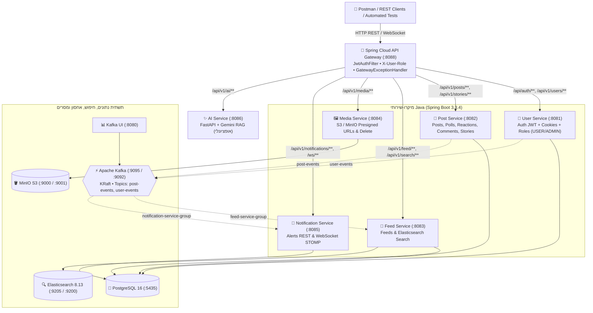

# 🌊 SocialFlow — פרויקט 1: רשת חברתית מבוזרת ב-Java Microservices (Back End Only)

[](https://www.oracle.com/java/)
[](https://spring.io/projects/spring-boot)
[](https://spring.io/projects/spring-cloud-gateway)
[](https://kafka.apache.org/)
[](https://www.elastic.co/)
[](https://www.postgresql.org/)
[](https://min.io/)
[](postman/SocialFlow.postman_collection.json)
[](render.yaml)

**SocialFlow** היא מערכת **Back End** מבוזרת ומונחית אירועים (Event-Driven Microservices) ב-**Java 17 & Spring Boot 3**, שתוכננה ונבנתה בהתאם לדרישות **פרויקט 1 בחוברת הקורס `Back End AI: Hi-Tech Gateway` (עמודים 10–11 ו-22)** — מיקרו-שירותים עצמאיים, **API Gateway**, אבטחת **JWT + HttpOnly Cookies + Roles**, **Apache Kafka**, **Elasticsearch 8**, אחסון תמונות ב-**S3 / MinIO**, טיפול מרכזי בשגיאות, בדיקות **JUnit 5 + Mockito**, אוסף **Postman**, **Docker Compose**, **Kubernetes** ו-**CI/CD**.

---

## 📑 תוכן העניינים
- [🏛 ארכיטקטורת המערכת](#-ארכיטקטורת-המערכת)
- [🧩 פירוט השירותים והתשתיות](#-פירוט-השירותים-והתשתיות)
- [🔒 אבטחת שרת, JWT, Cookies ו-Roles](#-אבטחת-שרת-jwt-cookies-ו-roles)
- [⚡ ארכיטקטורה מונחית אירועים (Kafka & Elasticsearch 8)](#-ארכיטקטורה-מונחית-אירועים-kafka--elasticsearch-8)
- [🌐 מיפוי פורטים וקונטיינרים](#-מיפוי-פורטים-וקונטיינרים)
- [📡 תיעוד ה-REST API ובדיקות Postman](#-תיעוד-ה-rest-api-ובדיקות-postman)
- [🚀 הרצה מקומית (Docker Compose) ו-Kubernetes](#-הרצה-מקומית-docker-compose-ו-kubernetes)
- [☁️ פריסה בענן (Render Blueprint)](#️-פריסה-בענן-render-blueprint)
- [🧪 בדיקות יחידה, אינטגרציה ו-CI/CD](#-בדיקות-יחידה-אינטגרציה-ו-cicd)
- [📁 מבנה הפרויקט](#-מבנה-הפרויקט)

---

## 🏛 ארכיטקטורת המערכת

המערכת מבוססת על **Database-per-Service** והפרדת אחריות מלאה (Decoupling). כל קריאות ה-REST וה-WebSocket נכנסות דרך **API Gateway (`:8088`)**, אימות ה-`JWT` והרשאות ה-`Roles` מועברים לשירותים, והעדכונים האסינכרוניים זורמים דרך **Apache Kafka** אל **Elasticsearch 8** ומנגנון ההתראות.



---

## 🧩 פירוט השירותים והתשתיות

| # | שם השירות | טכנולוגיה | פורט מקומי | תחומי אחריות מרכזיים |
| :---: | :--- | :--- | :---: | :--- |
| 1 | **`socialflow-api-gateway`** | Spring Cloud Gateway (Netty WebFlux) | `8088` | ניתוב מרכזי, פילטר `JWT` (`Bearer` + `HttpOnly Cookie`), העברת `X-User-Role` / `X-User-Id`, מדיניות CORS וטיפול שגיאות מרכזי (`GatewayExceptionHandler`). |
| 2 | **`socialflow-user-service`** | Spring Boot 3, Spring Security, JPA | `8081` | רישום והתחברות (`username` או `email`), `HttpOnly` JWT עם `role` (`USER` / `ADMIN`), אכיפת `@EnableMethodSecurity` ו-`@PreAuthorize`, עדכון פרופיל ומעקב (`Follow / Unfollow`). |
| 3 | **`socialflow-post-service`** | Spring Boot 3, Hibernate, Kafka Producer | `8082` | יצירה/מחיקת פוסטים (בעלים או `ADMIN`), סקרים, `Reactions`, תגובות, סימניות, סטוריז ושידור ל-Kafka. |
| 4 | **`socialflow-feed-service`** | Spring Boot 3, Spring Data Elasticsearch | `8083` | צריכת אירועים מ-Kafka, אינדוקס ומחיקה בזמן אמת ב-`Elasticsearch 8`, פידים וחיפוש טקסט מלא / האשטאגים. |
| 5 | **`socialflow-media-service`** | Spring Boot 3, AWS S3 SDK v2 | `8084` | בידוד הגישה ל-`S3 / MinIO`: יצירת `Presigned URLs` להעלאת תמונות ומדיה ומחיקת אובייקטים עם בדיקת בעלות/`ADMIN`. |
| 6 | **`socialflow-notification-service`** | Spring Boot 3, WebSocket STOMP, Kafka Consumer | `8085` | האזנה עצמאית ל-`post-events` ו-`user-events`, שמירת התראות ב-DB, ממשק REST ודחיפה בזמן אמת ב-`WebSocket`. |
| 7 | **`socialflow-ai-service`** | Python 3.11, FastAPI, Gemini SDK | `8086` | שירות עזר אופציונלי לניתוח פוסטים ו-RAG. |
| 8 | **`socialflow-postgres`** | PostgreSQL 16 Alpine | `5435` | מסד נתונים מבודד לכל מיקרו-שירות (`socialflow_db`, `post_db`, `feed_db`, `notification_db`). |
| 9 | **`socialflow-kafka` + `kafka-ui`** | Confluent Kafka 7.6.0 (`KRaft`) + Provectus UI | `9095` / `8080` | אפיק אירועים אסינכרוני וממשק ניטור ויזואלי ל-Topics ולצרכנים. |
| 10 | **`socialflow-elasticsearch`** | Elasticsearch 8.13.0 | `9205` | אינדוקס וחיפוש מהיר של פוסטים ותגיות. |
| 11 | **`socialflow-minio`** | MinIO Object Storage (`S3 API`) | `9000` / `9001` | אחסון מדיה ותמונות פרופיל מקומי תואם `S3`. |

---

## 🔒 אבטחת שרת, JWT, Cookies ו-Roles

- **הנפקת JWT ו-Cookies**: שירות `user-service` מפיק טוקן `JWT` הכולל `userId`, `email`, `sub` ו-`role` (`USER` כברירת מחדל, `ADMIN` לניהול), ומחזיר אותו הן בגוף ה-JSON והן כ-`Set-Cookie: jwt=...; HttpOnly; SameSite=Lax`.
- **שער כניסה מאובטח (`api-gateway`)**: `JwtAuthFilter` מאמת את החתימה והתוקף עוד בשער (`401 Unauthorized` ב-JSON מובנה לבקשות ללא טוקן בנתיבים מוגנים), ומעביר כותרות זיהוי (`X-User-Id`, `X-Auth-Username`, `X-User-Role`) לכל מיקרו-שירות.
- **הרשאות ברמת המתודה (`@PreAuthorize`)**:
  - `user-service`: `PUT /api/v1/users/{target}/role` פתוח ל-`ADMIN` בלבד; עדכון פרופיל פתוח לבעלים או ל-`ADMIN`.
  - `post-service`: פעולות כתיבה ו-`/bookmarks` דורשות `.authenticated()`, ומחיקת פוסט מותרת לבעל הפוסט או ל-`ADMIN`.
  - `media-service`: מחיקת אובייקט (`DELETE /api/v1/media?key=...`) מותרת לבעל הקובץ (`uploads/{userId}/...`) או ל-`ADMIN`.
- **ניהול שגיאות מרכזי**: בכל 5 שירותי ה-Spring MVC קיים `@RestControllerAdvice` (`GlobalExceptionHandler`), וב-`api-gateway` קיים `GatewayExceptionHandler` (`ErrorWebExceptionHandler`).

---

## ⚡ ארכיטורה מונחית אירועים (Kafka & Elasticsearch 8)

- **`post-events`** (נשלח מ-`post-service`): `POST_CREATED`, `POST_LIKED`, `COMMENT_CREATED`, `POST_REPOSTED`, `POST_PINNED`, `POST_DELETED`.
- **`user-events`** (נשלח מ-`user-service`): `UserRegisteredEvent`, `UserFollowedEvent`.
- **קבוצות צרכנים (`Consumer Groups`) עצמאיות**:
  - `feed-service-group` ([`FeedKafkaConsumer`](feed-service/src/main/java/com/socialflow/feed/consumer/FeedKafkaConsumer.java)) — מאנדקס פוסטים, מעדכן מונים ומוחק פוסטים מ-`Elasticsearch` בעת `POST_DELETED`, ומעדכן קשרי מעקב ב-DB.
  - `notification-service-group` ([`NotificationKafkaConsumer`](notification-service/src/main/java/com/socialflow/notification/service/NotificationKafkaConsumer.java)) — מתעד התראות `LIKE`, `COMMENT` ו-`FOLLOW` ושולח ב-`WebSocket`.

---

## 🌐 מיפוי פורטים וקונטיינרים

| שירות | פורט בקונטיינר | פורט במארח (Host) | כתובת גישה מקומית |
| :--- | :---: | :---: | :--- |
| **API Gateway** | `8088` | **`8088`** | `http://localhost:8088` |
| **User Service** | `8081` | **`8081`** | `http://localhost:8081/actuator/health` |
| **Post Service** | `8082` | **`8082`** | `http://localhost:8082/actuator/health` |
| **Feed Service** | `8083` | **`8083`** | `http://localhost:8083/actuator/health` |
| **Media Service** | `8084` | **`8084`** | `http://localhost:8084/actuator/health` |
| **Notification Service** | `8085` | **`8085`** | `http://localhost:8085/actuator/health` |
| **AI Service** | `8086` | **`8086`** | `http://localhost:8086/health` |
| **Kafka UI** | `8080` | **`8080`** | `http://localhost:8080` |
| **Apache Kafka** | `9092` | **`9095`** | `localhost:9095` |
| **PostgreSQL 16** | `5432` | **`5435`** | `localhost:5435` |
| **Elasticsearch 8** | `9200` | **`9205`** | `http://localhost:9205` |
| **MinIO S3 API / Console** | `9000` / `9001` | **`9000`** / **`9001`** | `http://localhost:9001` |

---

## 📡 תיעוד ה-REST API ובדיקות Postman

כל הבקשות נשלחות דרך ה-API Gateway בכתובת `http://localhost:8088`.
אוסף ה-**Postman** המלא מוכן לייבוא בנתיב: [`postman/SocialFlow.postman_collection.json`](postman/SocialFlow.postman_collection.json) (כולל סקריפט אוטומטי לשמירת `{{jwt_token}}` מבקשת `Login`).

- **אימות ומשתמשים (`/api/auth/**`, `/api/v1/users/**`)**: `POST /api/auth/register`, `POST /api/auth/login`, `GET /api/v1/users/profile/{username}`, `PUT /api/v1/users/profile`, `PUT /api/v1/users/{target}/role` (`ADMIN`), `GET /api/v1/users/search?q=`, `POST/DELETE /api/v1/users/{target}/follow`.
- **פוסטים, סקרים וסטוריז (`/api/v1/posts/**`, `/api/v1/stories/**`)**: `POST /api/v1/posts`, `GET /api/v1/posts/{id}`, `DELETE /api/v1/posts/{id}`, `POST /{id}/like`, `POST /{id}/reactions`, `POST /{id}/comments`, `POST /{id}/poll/vote`, `POST /{id}/bookmark`, `GET /api/v1/stories`.
- **פיד וחיפוש Elasticsearch (`/api/v1/feed/**`, `/api/v1/search/**`)**: `GET /api/v1/feed/for-you`, `following`, `trending`, `trending-tags`, `GET /api/v1/search?q=`, `GET /api/v1/search/multi?q=`, `GET /api/v1/search/tag/{tag}`.
- **מדיה S3 / MinIO (`/api/v1/media/**`)**: `POST /api/v1/media/upload-url` (Presigned PUT URL), `DELETE /api/v1/media?key=...`.
- **התראות (`/api/v1/notifications/**`, `/ws/**`)**: `GET /api/v1/notifications`, `GET /unread-count`, `PATCH /read-all`, ו-`WS /ws`.
- **בריאות (`Actuator`)**: `GET /actuator/health` בכל השירותים.

---

## 🚀 הרצה מקומית (Docker Compose) ו-Kubernetes

### Docker Compose
```powershell
git clone https://github.com/IDAN2468D/Social_Flow.git
cd Social_Flow
docker compose up -d --build
docker compose ps
```
או באמצעות הסקריפטים [`start_docker.ps1`](start_docker.ps1) / [`stop_docker.ps1`](stop_docker.ps1).

### Kubernetes (`k8s/`)
```bash
kubectl apply -f k8s/configmap.yaml
kubectl apply -f k8s/postgres.yaml -f k8s/kafka.yaml -f k8s/elasticsearch.yaml -f k8s/minio.yaml
kubectl apply -f k8s/user-service.yaml -f k8s/post-service.yaml -f k8s/feed-service.yaml -f k8s/media-service.yaml -f k8s/notification-service.yaml -f k8s/api-gateway.yaml
```

---

## ☁️ פריסה בענן (Render Blueprint)

קובץ [`render.yaml`](render.yaml) מגדיר את פריסת ה-Back End ב-**Render**:
- **Web Services (`plan: free`)**: `socialflow-api-gateway`, `socialflow-user-service`, `socialflow-post-service`, `socialflow-feed-service`, `socialflow-media-service`, `socialflow-notification-service`, `socialflow-ai-service`, `socialflow-kafka-ui`.
- **Private Services (`type: pserv`, בתשלום)**: `socialflow-kafka` (`plan: starter`), `socialflow-elasticsearch` (`plan: standard`).
- **Database**: `socialflow-postgres` (`PostgreSQL 16`).

---

## 🧪 בדיקות יחידה, אינטגרציה ו-CI/CD

- **הרצת בדיקות Java (`JUnit 5 + Mockito`) בכל המודולים**:
  ```bash
  mvn test
  ```
- **בדיקת תקינות `docker-compose.yml`**:
  ```bash
  docker compose config -q
  ```
- **בדיקות E2E על סביבה מקומית פועלת**:
  ```powershell
  ./comprehensive_test.ps1
  ```
- **GitHub Actions CI/CD**: קובץ [`.github/workflows/ci.yml`](.github/workflows/ci.yml) מריץ אוטומטית את `mvn test`, `pytest ai-service/tests/test_agent.py`, ובדיקת `docker compose config -q` בכל `Push` ו-`Pull Request`.

---

## 📁 מבנה הפרויקט

```text
Social_Flow/
├── .github/workflows/ci.yml       # CI/CD: Maven tests, AI pytest, Docker Compose config
├── .agents/                       # PRD.md, SPEC.md, PLAN.md (Pure Back End Spec)
├── docker-compose.yml             # תזמור שירותי Back End ותשתיות מקומית
├── render.yaml                    # Render Cloud Blueprint
├── init-db.sql                    # אתחול סכמות PostgreSQL
├── pom.xml                        # Maven Multi-Module ראשי
│
├── api-gateway/                   # Spring Cloud Gateway (:8088) + JwtAuthFilter + GatewayExceptionHandler
├── user-service/                  # משתמשים, JWT + Cookies, Roles USER/ADMIN (:8081)
├── post-service/                  # פוסטים, סקרים, תגובות, ריאקשנים, סטוריז (:8082)
├── feed-service/                  # פידים וחיפוש Elasticsearch 8 + Kafka Consumer (:8083)
├── media-service/                 # שירות Presigned URLs ומחיקה מול MinIO / S3 (:8084)
├── notification-service/          # התראות, WebSocket STOMP + Kafka Consumer (:8085)
├── ai-service/                    # שירות עזר Python FastAPI + Gemini (:8086)
│
├── kafka/Dockerfile               # תמונת Kafka (KRaft) לענן
├── kafka-ui/Dockerfile            # תמונת Kafka UI לענן
├── elasticsearch/Dockerfile       # תמונת Elasticsearch 8.13.0 לענן
├── k8s/                           # מניפסטים של Kubernetes לכל המיקרו-שירותים והתשתיות
├── mcp-server/                    # שרת MCP לחיבור כלי AI ל-API
├── postman/                       # אוסף Postman מלא (SocialFlow.postman_collection.json)
└── comprehensive_test.ps1         # בדיקת E2E מקומית מול ה-Gateway והתשתיות
```

---

## 👨‍💻 יוצר ורישיון

פותח על ידי **[עידן קזם (Idan Kazam)](https://github.com/IDAN2468D)** במסגרת פרויקט 1 בקורס **Back End AI: Hi-Tech Gateway**.
מופץ תחת רישיון **MIT License**.
