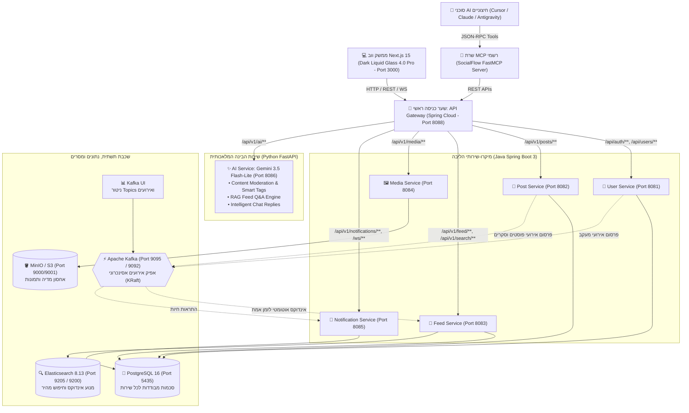

# 🌊 SocialFlow — פלטפורמת רשת חברתית מבוזרת ומבוססת בינה מלאכותית (AI)

[](https://nextjs.org/)
[](https://www.oracle.com/java/)
[](https://spring.io/projects/spring-boot)
[](https://spring.io/projects/spring-cloud-gateway)
[](https://aistudio.google.com/)
[-blue.svg?style=flat)](https://modelcontextprotocol.io/)
[](https://kafka.apache.org/)
[](https://www.elastic.co/)
[](https://www.postgresql.org/)
[](https://min.io/)
[](https://render.com/)

**SocialFlow** היא פלטפורמת רשת חברתית מתקדמת בארכיטקטורת מיקרו-שירותים מבוזרת ומונחית אירועים (Event-Driven Microservices), המשלבת ממשק **Next.js 15** בעיצוב **Dark Liquid Glass 4.0 Pro**, שירותי **Spring Boot 3**, מנוע בינה מלאכותית **Google Gemini 3.5 Flash-Lite**, שרת **MCP (Model Context Protocol)**, **Apache Kafka** וחיפוש **Elasticsearch**.

המערכת בנויה לפי עקרונות הפרדת שירותים מלאה, מוכנה להרצה מקומית מלאה באמצעות **Docker Compose** ולפריסה בענן באמצעות **Render Blueprint** (`render.yaml`).

---

## 📑 תוכן העניינים
- [🏛 ארכיטקטורת המערכת](#-ארכיטקטורת-המערכת)
- [🎨 ממשק Dark Liquid Glass 4.0 Pro וניתוב דפים](#-ממשק-dark-liquid-glass-40-pro-וניתוב-דפים)
- [🧩 פירוט המיקרו-שירותים והרכיבים](#-פירוט-המיקרו-שירותים-והרכיבים)
- [🌟 פיצ'רים מרכזיים במערכת](#-פיצרים-מרכזיים-במערכת)
- [🤖 יכולות ה-AI ומנוע ה-RAG (Gemini 3.5 Flash-Lite)](#-יכולות-ה-ai-ומנוע-ה-rag-gemini-35-flash-lite)
- [🔌 שרת ה-MCP הרשמי (Model Context Protocol)](#-שרת-ה-mcp-הרשמי-model-context-protocol)
- [⚡ ארכיטקטורה מונחית אירועים (Kafka Topics)](#-ארכיטקטורה-מונחית-אירועים-kafka-topics)
- [🌐 מיפוי פורטים וקונטיינרים](#-מיפוי-פורטים-וקונטיינרים)
- [📡 תיעוד ה-REST API וה-WebSocket](#-תיעוד-ה-rest-api-וה-websocket)
- [🚀 מדריך התקנה והרצה מהירה (Docker Compose)](#-מדריך-התקנה-והרצה-מהירה-docker-compose)
- [☁️ פריסה בענן (Render Blueprint)](#️-פריסה-בענן-render-blueprint)
- [🔒 אבטחה ושמירת מפתחות סודיים](#-אבטחה-ושמירת-מפתחות-סודיים)
- [🧪 בדיקות אינטגרציה ו-CI/CD](#-בדיקות-אינטגרציה-ו-cicd)
- [📁 מבנה הקבצים והתיקיות בפרויקט](#-מבנה-הקבצים-והתיקיות-בפרויקט)
- [👨‍💻 יוצר ורישיון](#-יוצר-ורישיון)

---

## 🏛 ארכיטקטורת המערכת

המערכת מבוססת על עקרון **Database-per-Service** וניתוק צימוד (Decoupling) בין השירותים. כל התקשורת החיצונית מנותבת דרך **API Gateway**, העברת האירועים מתבצעת אסינכרונית דרך **Apache Kafka**, חיפושי הפיד מואצים באמצעות **Elasticsearch**, קובצי המדיה נשמרים ב-**MinIO / S3**, ורכיבי ה-AI מנוהלים עצמאית בשירות **FastAPI Python**.



---

## 🎨 ממשק Dark Liquid Glass 4.0 Pro וניתוב דפים

הפרונטאנד בנוי ב-**Next.js 15 (App Router)**, **React**, **TypeScript**, **Tailwind CSS**, **Framer Motion** ו-**Zustand**, עם תמיכה מלאה ב-**RTL** ועיצוב **Dark Liquid Glass 4.0 Pro** (רקע אובסידיאן `#090A0F`, כרטיסי זכוכית שקופים למחצה ותאורת אינדיגו/סגול).

### הפרדת מסכי האימות מהפיד
- **`/` (דף הבית — הפיד הראשי)**: מוגן אימות. משתמש ללא `JWT` תקף מופנה אוטומטית אל `/login` (`router.replace('/login')`), וסרגל הניווט הצדדי (`LeftNavRail`) כולל כפתור **התנתקות מהמערכת**.
- **`/login` ו-`/register` (מסכי אימות עצמאיים)**:
  - עיצוב ייעודי בסגנון **Dark Liquid Glass 4.0 Pro** עם בורר מצבים עליון (`התחברות` | `הרשמה`), ללא קישורי אורח או מעקף לפיד.
  - תמיכה בהתחברות לפי **שם משתמש או אימייל**.
  - תצוגה מקדימה חיה של אווטאר ב-`/register` לפי שם המשתמש.
  - טיפול מלא בצבעי `Autofill` כהים וגלישת הודעות שגיאה (`overflow-wrap: anywhere`).
- **עמודים נוספים**: `/stories` (נגן סטוריז), `/bookmarks` (סימניות), `/community` (קהילה), `/profile` ו-`/profile/[username]`.

---

## 🧩 פירוט המיקרו-שירותים והרכיבים

| # | שם השירות | טכנולוגיה | פורט מקומי | תפקיד ותחומי אחריות |
| :---: | :--- | :--- | :---: | :--- |
| 1 | **`socialflow-frontend`** | Next.js 15, React, TypeScript, Tailwind CSS | `3000` | ממשק **Dark Liquid Glass 4.0 Pro**, דפי `/login` ו-`/register` נפרדים, פיד, סטוריז, סימניות, קהילה ופרופיל. |
| 2 | **`socialflow-api-gateway`** | Spring Cloud Gateway (Netty Async) | `8088` | ניתוב מרכזי, אימות `JWT`, העברת כותרות זיהוי וניהול `CORS`. |
| 3 | **`socialflow-user-service`** | Spring Boot 3, Spring Security, JPA | `8081` | הרשמה והתחברות (`username` או `email`), הפקת `JWT`, שמירת `role` (`DEFAULT 'USER'`) ומעקב (`Follow / Unfollow`). |
| 4 | **`socialflow-post-service`** | Spring Boot 3, Hibernate, Kafka Producer | `8082` | פוסטים, סקרים חיים, 6 סוגי `Reactions`, תגובות, `Reposts` וסימניות. |
| 5 | **`socialflow-feed-service`** | Spring Boot 3, Elasticsearch Client | `8083` | פידים ("עבורך", "נעקבים", "טרנדים"), האשטאגים חמים וחיפוש טקסט ב-`Elasticsearch` (עם הגנת fallback). |
| 6 | **`socialflow-media-service`** | Spring Boot 3, AWS S3 Java SDK v2 | `8084` | העלאת מדיה והפקת `Presigned URLs` מול `MinIO` / `S3`. |
| 7 | **`socialflow-notification-service`** | Spring Boot 3, WebSocket (STOMP), JPA | `8085` | התראות בזמן אמת ב-`WebSocket` וניהול היסטוריית התראות. |
| 8 | **`socialflow-ai-service`** | Python 3.11, FastAPI, Google GenAI SDK | `8086` | ניתוח פוסטים, מנוע `RAG` על הפיד ומענה צ'אט בעברית עם **Gemini 3.5 Flash-Lite**. |
| 9 | **`socialflow-postgres`** | PostgreSQL 16 | `5435` | מסד נתונים רלציוני עם סכמות/טבלאות מבודדות (`user_db`, `post_db`, `feed_db`, `notif_db`). |
| 10 | **`socialflow-kafka`** | Confluent Kafka 7.6.0 (`KRaft`) | `9095` | מתווך אירועים מבוזר ללא Zookeeper (נתמך גם ב-Docker Compose וגם ב-`render.yaml`). |
| 11 | **`socialflow-kafka-ui`** | Provectus Kafka UI | ענן (`8080`) | ממשק ויזואלי לצפייה ב-Topics, הצרכנים וההודעות של `Kafka` ב-`Render`. |
| 12 | **`socialflow-elasticsearch`** | Elasticsearch 8.13.0 | `9205` | מנוע אינדוקס וחיפוש טקסט מלא לפוסטים (זמין גם ב-Docker Compose וגם ב-`render.yaml`). |
| 13 | **`socialflow-minio`** | MinIO Object Storage (`S3 API`) | `9000` / `9001` | אחסון אובייקטים מקומי תואם `S3` לתמונות וקובצי מדיה. |

---

## 🌟 פיצ'רים מרכזיים במערכת

- **📊 סקרים אינטראקטיביים חיים**: יצירת סקר מתיבת הפרסום, הצבעה בלחיצה אחת, חישוב אחוזים מונפש ומניעת הצבעה כפולה בשרת.
- **💬 צ'אט מסנג'ר פרטי (DMs)**: מגירת שיחות צפה ומנוע מענה חכם בעברית המשולב עם מודל ה-AI.
- **⭕ סטוריז זמניים (Stories ל-24 שעות)**: מגש סטוריז עליון בראש הפיד ונגן מסך מלא במסלול `/stories`.
- **👍 מערכת Reactions מתקדמת**: תמיכה ב-6 רגשות (`LIKE`, `LOVE`, `CELEBRATE`, `SUPPORT`, `INSIGHTFUL`, `FUNNY`).
- **📰 מגוון תצוגות פיד**: **עבורך (For You)**, **נעקבים (Following)**, **טרנדים (Trending)** וסינון לפי **האשטאגים חמים**.
- **🔔 התראות חיות בזמן אמת**: חיבור `WebSocket (STOMP)` עם עדכון מונה התראות רציף.

---

## 🤖 יכולות ה-AI ומנוע ה-RAG (Gemini 3.5 Flash-Lite)

שירות ה-`ai-service` מריץ את **Gemini 3.5 Flash-Lite**:

1. **✨ שיפור וניתוח פוסט (`POST /api/v1/ai/analyze`)**: משפר ניסוח, מפיק האשטאגים רלוונטיים ומבצע בדיקת נאותות תוכן.
2. **🔍 מנוע RAG לתשאול הפיד (`POST /api/v1/ai/ask-feed`)**: שולף פוסטים וסקרים עדכניים מ-`feed-service` ומפיק תשובה מנומקת בעברית עם מקורות.
3. **💬 מענה חכם בצ'אט (`POST /api/v1/ai/chat-reply`)**: מפיק תגובות צ'אט טבעיות בעברית.

---

## 🔌 שרת ה-MCP הרשמי (Model Context Protocol)

הפרויקט כולל שרת **MCP** בנתיב [`mcp-server/socialflow_mcp_server.py`](mcp-server/socialflow_mcp_server.py):
- `socialflow_get_feed`: שליפת פוסטים וסקרים מהפיד.
- `socialflow_create_post`: פרסום פוסטים או סקרים חדשים.
- `socialflow_vote_poll`: הצבעה בסקר פעיל.
- `socialflow_search`: חיפוש פוסטים, תגיות ומשתמשים.
- `socialflow_ask_feed_rag`: תשאול סמנטי של הפיד.
- `socialflow_system_health`: דוח בריאות שירותים.

---

## ⚡ ארכיטקטורה מונחית אירועים (Kafka Topics)

שרת ה-`Kafka` רץ במצב `KRaft` (פורט `9095` מקומית, `9092` פנימית ב-Docker/Render):
- **`post-events`**: יצירה/עריכה של פוסט או סקר -> אינדוקס אסינכרוני ב-`feed-service` / `Elasticsearch`.
- **`user-events`**: פעולות מעקב (`Follow / Unfollow`) -> עדכון גרף הנעקבים.
- **`reaction-events`**: סימון תגובות וריאקשנים -> עדכון מדדי טרנדים.
- **`notification-events`**: הפצת התראות בזמן אמת ל-`WebSocket` ב-`notification-service`.

---

## 🌐 מיפוי פורטים וקונטיינרים

| שירות | פורט פנימי בקונטיינר | פורט גישה מקומי (Host) | כתובת גישה מקומית |
| :--- | :---: | :---: | :--- |
| **ממשק המשתמש (`frontend`)** | `3000` | **`3000`** | [http://localhost:3000](http://localhost:3000) |
| **שער הכניסה (`api-gateway`)** | `8088` | **`8088`** | [http://localhost:8088](http://localhost:8088) |
| **שירות AI (`ai-service`)** | `8086` | **`8086`** | [http://localhost:8086/health](http://localhost:8086/health) |
| **שירות משתמשים (`user-service`)** | `8081` | **`8081`** | [http://localhost:8081](http://localhost:8081) |
| **שירות פוסטים (`post-service`)** | `8082` | **`8082`** | [http://localhost:8082](http://localhost:8082) |
| **שירות פיד (`feed-service`)** | `8083` | **`8083`** | [http://localhost:8083](http://localhost:8083) |
| **שירות מדיה (`media-service`)** | `8084` | **`8084`** | [http://localhost:8084](http://localhost:8084) |
| **שירות התראות (`notification-service`)** | `8085` | **`8085`** | [http://localhost:8085](http://localhost:8085) |
| **אחסון `MinIO S3 API`** | `9000` | **`9000`** | [http://localhost:9000](http://localhost:9000) |
| **לוח ניהול `MinIO Console`** | `9001` | **`9001`** | [http://localhost:9001](http://localhost:9001) |
| **מסד נתונים `PostgreSQL`** | `5432` | **`5435`** | `localhost:5435` |
| **מתווך מסרים `Apache Kafka`** | `9092` | **`9095`** | `localhost:9095` |
| **מנוע חיפוש `Elasticsearch`** | `9200` | **`9205`** | [http://localhost:9205](http://localhost:9205) |

---

## 📡 תיעוד ה-REST API וה-WebSocket

כל הבקשות מבוצעות דרך שער הכניסה הראשי (`http://localhost:8088` מקומית או `/api/*` דרך ה-Next.js Proxy):

### 1. אימות ומשתמשים (`/api/auth/**`, `/api/users/**`)
- `POST /api/auth/register` — הרשמת משתמש חדש והפקת `JWT`.
- `POST /api/auth/login` — התחברות לפי `username` או `email` וקבלת `JWT`.
- `GET /api/users/profile/{username}` — פרטי פרופיל וסטטיסטיקות.
- `POST /api/users/{userId}/follow` / `DELETE /api/users/{userId}/unfollow` — ניהול מעקב.

### 2. פוסטים, סקרים ואינטראקציות (`/api/v1/posts/**`)
- `POST /api/v1/posts` — יצירת פוסט חדש (טקסט, מדיה, סקר).
- `GET /api/v1/posts/{id}` — שליפת פוסט כולל פרטי סקר.
- `POST /api/v1/posts/{id}/poll/vote?optionId={optId}` — הצבעה בסקר חי.
- `POST /api/v1/posts/{id}/reactions` — הוספה/עדכון Reaction.
- `POST /api/v1/posts/{id}/comments`, `POST /api/v1/posts/{id}/repost`, `POST /api/v1/posts/{id}/bookmark`.

### 3. פידים וחיפוש (`/api/v1/feed/**`, `/api/v1/search/**`)
- `GET /api/v1/feed/for-you`, `GET /api/v1/feed/following`, `GET /api/v1/feed/trending`, `GET /api/v1/feed/trending-tags`.
- `GET /api/v1/search?query={q}` — חיפוש טקסט מלא ב-`Elasticsearch`.

### 4. שירותי בינה מלאכותית (`/api/v1/ai/**`) ו-WebSocket (`/ws`)
- `POST /api/v1/ai/analyze`, `POST /api/v1/ai/smart-replies`, `POST /api/v1/ai/ask-feed`, `POST /api/v1/ai/chat-reply`.
- `GET /api/v1/notifications`, `PUT /api/v1/notifications/read-all`, `WS /ws` (`SockJS / STOMP`).

---

## 🚀 מדריך התקנה והרצה מהירה (Docker Compose)

### דרישות מקדימות
- **[Docker Desktop](https://www.docker.com/products/docker-desktop/)** (גרסה 24 ומעלה)
- **Git**

### הרצה מקומית מלאה:
```bash
git clone https://github.com/IDAN2468D/Social_Flow.git
cd Social_Flow
docker compose up -d --build
```

בדיקת מצב הקונטיינרים:
```bash
docker compose ps
```

לאחר העלייה, הממשק זמין בכתובת: **[http://localhost:3000](http://localhost:3000)** (ומפנה אוטומטית ל-`/login`).

---

## ☁️ פריסה בענן (Render Blueprint)

קובץ [`render.yaml`](render.yaml) מגדיר את כל התשתית לפריסה ב-**Render** כ-Blueprint אחד:

- **Web Services (`plan: free`)**:
  - `socialflow-frontend` (`./frontend/Dockerfile`)
  - `socialflow-api-gateway` (`./api-gateway/Dockerfile`)
  - `socialflow-user-service` (`./user-service/Dockerfile`)
  - `socialflow-post-service` (`./post-service/Dockerfile`)
  - `socialflow-feed-service` (`./feed-service/Dockerfile`)
  - `socialflow-media-service` (`./media-service/Dockerfile`)
  - `socialflow-notification-service` (`./notification-service/Dockerfile`)
  - `socialflow-ai-service` (`./ai-service/Dockerfile`)
  - `socialflow-kafka-ui` (`./kafka-ui/Dockerfile`) — ממשק ניהול ויזואלי ל-`Kafka`
- **Private Services (`type: pserv` — תוכנית בתשלום ב-Render)**:
  - `socialflow-kafka` (`./kafka/Dockerfile`, `plan: starter`) — מתווך `Kafka` ב-`KRaft` על פורט פנימי `9092`
  - `socialflow-elasticsearch` (`./elasticsearch/Dockerfile`, `plan: standard`) — שרת `Elasticsearch 8.13.0` (`2GB RAM`) על פורט פנימי `9200`
- **Managed Database**:
  - `socialflow-postgres` (`PostgreSQL 16`, `plan: free`)

> **שימו לב**: כל שירותי ה-Java (`Spring Boot 3`) מוגדרים ב-`render.yaml` עם מגבלות זיכרון מותאמות ל-`512MB` (`JAVA_TOOL_OPTIONS`) ועם חיבור אוטומטי ל-`socialflow-kafka` ול-`socialflow-elasticsearch` דרך `fromService`.

---

## 🔒 אבטחה ושמירת מפתחות סודיים

1. **הגנה מלאה ב-Git**: קובץ [`.gitignore`](.gitignore) חוסם קובצי `.env` וסודות.
2. **הגדרת מפתחות**:
   - מקומית: שמרו את `GEMINI_API_KEY` בקובץ `.env` בתיקיית השורש.
   - ב-`Render`: הזינו בלוח הבקרה בקבוצת `socialflow-shared-env` את `GEMINI_API_KEY` ואת פרטי ה-`S3` / `MinIO` (`AWS_S3_ENDPOINT`, `AWS_ACCESS_KEY_ID`, `AWS_SECRET_ACCESS_KEY`).

---

## 🧪 בדיקות אינטגרציה ו-CI/CD

- **בדיקות Backend (`Maven`)**:
  ```bash
  mvn test
  ```
- **בדיקות Frontend (`TypeScript` + `Next.js Build`)**:
  ```bash
  cd frontend
  npx tsc --noEmit && npm run build
  ```
- **צינור אוטומטי (`.github/workflows/ci.yml`)**: מריץ קומפילציה ובדיקות אוטומטיות בכל `Push` ו-`Pull Request`.
- **אוסף Postman**: זמין בתיקיית `postman/` (`SocialFlow.postman_collection.json`).

---

## 📁 מבנה הקבצים והתיקיות בפרויקט

```text
Social_Flow/
├── .github/workflows/ci.yml       # צינור CI/CD ב-GitHub Actions
├── .gitignore                     # חסימת קבצים רגישים, target ו-node_modules
├── README.md                      # תיעוד הפרויקט המלא
├── docker-compose.yml             # תזמור הקונטיינרים להרצה מקומית
├── render.yaml                    # Blueprint מלא לפריסה בענן Render
├── init-db.sql                    # אתחול סכמות PostgreSQL
├── pom.xml                        # Maven Multi-Module ראשי
│
├── api-gateway/                   # שער כניסה (Spring Cloud Gateway - 8088)
├── user-service/                  # משתמשים ואימות JWT (8081)
├── post-service/                  # פוסטים, סקרים, תגובות וריאקשנים (8082)
├── feed-service/                  # פידים וחיפוש Elasticsearch (8083)
├── media-service/                 # העלאת מדיה ו-S3 / MinIO (8084)
├── notification-service/          # התראות ו-WebSocket STOMP (8085)
├── ai-service/                    # שירות AI (FastAPI + Gemini 3.5 Flash-Lite - 8086)
│
├── kafka/Dockerfile               # תמונת Apache Kafka (KRaft) לפריסה ב-Render
├── kafka-ui/Dockerfile            # תמונת Kafka UI לצפייה באירועים ו-Topics
├── elasticsearch/Dockerfile       # תמונת Elasticsearch 8.13.0 לפריסה ב-Render
├── k8s/                           # מניפסטים של Kubernetes
│
├── mcp-server/                    # שרת Model Context Protocol לסוכני AI
├── frontend/                      # ממשק Next.js 15 (Dark Liquid Glass 4.0 Pro)
│   ├── app/                       # App Router: /, /login, /register, /stories, /bookmarks, /community, /profile
│   ├── components/                # רכיבי UI, פיד, סקרים, צ'אט וסרגלי ניווט
│   ├── lib/                       # כלי עזר לאימות ו-API
│   ├── store/                     # ניהול State גלובלי עם Zustand
│   └── Dockerfile                 # בניית Frontend לפריסה
└── postman/                       # אוסף קריאות API לבדיקות
```

---

## 👨‍💻 יוצר ורישיון

פותח על ידי **[עידן קזם (Idan Kazam)](https://github.com/IDAN2468D)**.

פרויקט זה מופץ תחת רישיון **MIT License** — חופשי לשימוש, למידה, שיתוף והרחבה.
