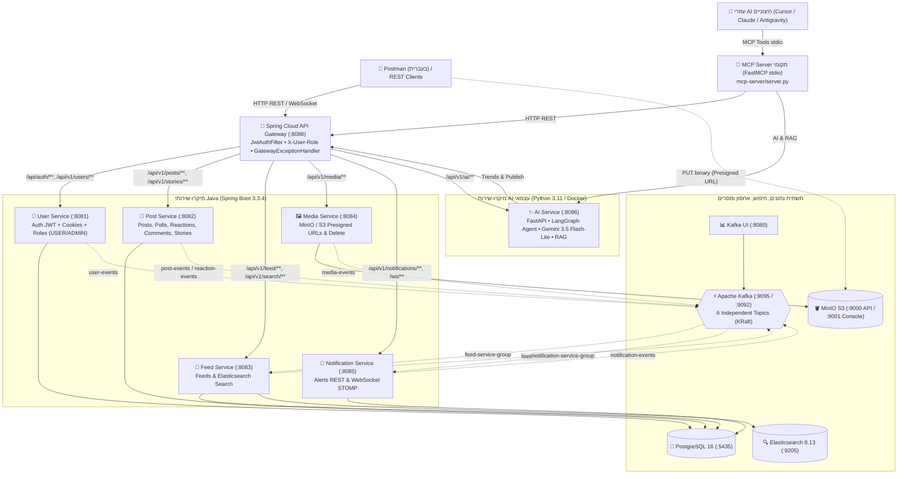

# 🌊 SocialFlow — פרויקט 1: רשת חברתית מבוזרת ב-Microservices, Kafka ו-AI

[](https://www.oracle.com/java/)
[](https://spring.io/projects/spring-boot)
[](https://spring.io/projects/spring-cloud-gateway)
[](https://kafka.apache.org/)
[](https://www.elastic.co/)
[](https://www.postgresql.org/)
[](https://min.io/)
[](ai-service/app/main.py)
[](mcp-server/server.py)
[](postman/SocialFlow.postman_collection.json)
[](render.yaml)

**SocialFlow** היא מערכת **Back End** מבוזרת ומונחית אירועים (Event-Driven Microservices) ב-**Java 17 & Spring Boot 3** בשילוב מיקרו-שירות סוכני **Python AI (`FastAPI` + `LangGraph` + `Google Gemini 3.5 Flash-Lite`)** ושרת **MCP (Model Context Protocol)**. המערכת תוכננה ונבנתה בהתאם לדרישות **פרויקט 1 בחוברת הקורס `Back End AI: Hi-Tech Gateway`** — כולל **6 טופיקי Kafka עצמאיים**, **API Gateway**, אבטחת **JWT + HttpOnly Cookies + Roles**, **Elasticsearch 8**, אחסון תמונות ב-**MinIO S3 (Presigned URLs)**, טיפול שגיאות מרכזי, אוספי **Postman בעברית**, **Docker Compose**, **Kubernetes** ו-**CI/CD**.

---

## 📑 תוכן העניינים
- [🏛 ארכיטקטורת המערכת](#-ארכיטקטורת-המערכת)
- [🧩 פירוט השירותים והתשתיות](#-פירוט-השירותים-והתשתיות)
- [🔒 אבטחת שרת, JWT, Cookies ו-Roles](#-אבטחת-שרת-jwt-cookies-ו-roles)
- [⚡ ארכיטקטורה מונחית אירועים — 6 טופיקי Kafka עצמאיים](#-ארכיטקטורה-מונחית-אירועים--6-טופיקי-kafka-עצמאיים)
- [🖼️ אחסון מדיה ב-MinIO / S3 והעלאת תמונות ב-2 שלבים (POST מול PUT)](#️-אחסון-מדיה-ב-minio--s3-והעלאת-תמונות-ב-2-שלבים-post-מול-put)
- [🤖 סוכני בינה מלאכותית ב-Python (`ai-service` + `mcp-server`)](#-סוכני-בינה-מלאכותית-ב-python-ai-service--mcp-server)
- [🌐 מיפוי פורטים וקונטיינרים](#-מיפוי-פורטים-וקונטיינרים)
- [📡 תיעוד ה-REST API ואוספי Postman בעברית](#-תיעוד-ה-rest-api-ואוספי-postman-בעברית)
- [🚀 הרצה מקומית (Docker Compose) ו-Kubernetes](#-הרצה-מקומית-docker-compose-ו-kubernetes)
- [☁️ פריסה בענן (Render Blueprint)](#️-פריסה-בענן-render-blueprint)
- [🧪 בדיקות יחידה, אינטגרציה ו-CI/CD](#-בדיקות-יחידה-אינטגרציה-ו-cicd)
- [📁 מבנה הפרויקט](#-מבנה-הפרויקט)

---

## 🏛 ארכיטקטורת המערכת

המערכת מבוססת על **Database-per-Service** והפרדת אחריות מלאה (Decoupling). כל קריאות ה-REST וה-WebSocket נכנסות דרך **API Gateway (`:8088`)**, אימות ה-`JWT` והרשאות ה-`Roles` מועברים לשירותים, כל אחד מ-**6 טופיקי Kafka** מופרד ופועל באופן עצמאי, חיפוש הפיד רץ על **Elasticsearch 8**, המדיה נשמרת ב-**MinIO S3**, וסוכן ה-`LangGraph` פועל כמיקרו-שירות `Python` עצמאי (`:8086`).



---

## 🧩 פירוט השירותים והתשתיות

| # | שם השירות | טכנולוגיה | פורט מקומי | תחומי אחריות מרכזיים |
| :---: | :--- | :--- | :---: | :--- |
| 1 | **`socialflow-api-gateway`** | Spring Cloud Gateway (Netty WebFlux) | `8088` | ניתוב מרכזי, פילטר `JWT` (`Bearer` + `HttpOnly Cookie`), העברת `X-User-Role` / `X-User-Id`, מדיניות CORS וטיפול שגיאות מרכזי (`GatewayExceptionHandler`). |
| 2 | **`socialflow-user-service`** | Spring Boot 3, Spring Security, JPA | `8081` | רישום והתחברות (`username` או `email`), `HttpOnly` JWT עם `role` (`USER` / `ADMIN`), אכיפת `@EnableMethodSecurity` ו-`@PreAuthorize`, עדכון פרופיל, מעקב (`Follow / Unfollow`) ופרסום ל-`user-events`. |
| 3 | **`socialflow-post-service`** | Spring Boot 3, Hibernate, Kafka Producer | `8082` | יצירה/מחיקת פוסטים (בעלים או `ADMIN`), סקרים, `Reactions`, לייקים, תגובות, סימניות, סטוריז והפרדת פרסום ל-`post-events` ול-`reaction-events`. |
| 4 | **`socialflow-feed-service`** | Spring Boot 3, Spring Data Elasticsearch | `8083` | צריכת `post-events`, `reaction-events` ו-`user-events`, אינדוקס ומחיקה בזמן אמת ב-`Elasticsearch 8`, פידים, חיפוש ופרסום אירועי פיד ל-`feed-events`. |
| 5 | **`socialflow-media-service`** | Spring Boot 3, AWS S3 SDK v2, Kafka | `8084` | בידוד הגישה ל-`MinIO / S3`: יצירת `Presigned URLs` להעלאת תמונות, מחיקת אובייקטים (בעלים או `ADMIN`) ופרסום ל-`media-events`. |
| 6 | **`socialflow-notification-service`** | Spring Boot 3, WebSocket STOMP, Kafka | `8085` | האזנה ל-`post-events`, `reaction-events` ו-`user-events`, יצירת התראות ישירות (`POST /api/v1/notifications`), דחיפה ב-`WebSocket` ופרסום ל-`notification-events`. |
| 7 | **`socialflow-ai-service`** | Python 3.11, FastAPI, LangGraph, Gemini | `8086` | מיקרו-שירות AI עצמאי: סוכן `LangGraph` רב-שלבי (מחקר טרנדים, ניסוח, מודרציה ופרסום), `RAG` על הפיד, ניתוח תוכן ותגובות חכמות. |
| 8 | **`mcp-server`** *(מקומי)* | Python 3, FastMCP (`stdio`) | מקומי | סקריפט גשר `Model Context Protocol` המחבר כלי AI חיצוניים (`Cursor`, `Claude Desktop`, `Antigravity`) למערכת. |
| 9 | **`socialflow-postgres`** | PostgreSQL 16 Alpine | `5435` | מסד נתונים מבודד לכל מיקרו-שירות (`socialflow_db`, `post_db`, `feed_db`, `notification_db`). |
| 10 | **`socialflow-kafka` + `kafka-ui`** | Confluent Kafka 7.6.0 (`KRaft`) + UI | `9095` / `8080` | מתווך מסרים אסינכרוני ל-6 טופיקים עצמאיים וממשק ניטור ויזואלי (`http://localhost:8080`). |
| 11 | **`socialflow-elasticsearch`** | Elasticsearch 8.13.0 | `9205` | אינדוקס וחיפוש טקסט מלא מהיר של פוסטים והאשטאגים. |
| 12 | **`socialflow-minio`** | MinIO Object Storage (`S3 API`) | `9000` / `9001` | שרת אחסון אובייקטים מקומי וחינמי לצמיתות התואם במלואו ל-AWS S3 API. |

---

## 🔒 אבטחת שרת, JWT, Cookies ו-Roles

- **הנפקת JWT ו-Cookies**: שירות `user-service` מפיק טוקן `JWT` הכולל `userId`, `email`, `sub` ו-`role` (`USER` כברירת מחדל, `ADMIN` לניהול), ומחזיר אותו הן בגוף ה-JSON והן כ-`Set-Cookie: jwt=...; HttpOnly; SameSite=Lax`.
- **שער כניסה מאובטח (`api-gateway`)**: `JwtAuthFilter` מאמת את החתימה והתוקף עוד בשער (`401 Unauthorized` ב-JSON מובנה לבקשות ללא טוקן בנתיבים מוגנים), ומעביר כותרות זיהוי (`X-User-Id`, `X-Auth-Username`, `X-User-Role`) לכל מיקרו-שירות.
- **הרשאות ברמת המתודה (`@PreAuthorize`)**:
  - `user-service`: `PUT /api/v1/users/{target}/role` פתוח ל-`ADMIN` בלבד; עדכון פרופיל פתוח לבעלים או ל-`ADMIN`.
  - `post-service`: פעולות כתיבה ו-`/bookmarks` דורשות `.authenticated()`, ומחיקת פוסט מותרת לבעל הפוסט או ל-`ADMIN`.
  - `media-service`: מחיקת אובייקט (`DELETE /api/v1/media?key=...`) מותרת לבעל הקובץ (`uploads/{userId}/...`) או ל-`ADMIN`.
- **תשובות JSON נקיות ללא `null`**: בכל 5 שירותי ה-Java מוגדר `spring.jackson.default-property-inclusion: non_null` (וגם ב-`ai-service` מסוננים שדות ריקים) כדי שתגובות ה-REST ואירועי ה-Kafka יהיו נקיים משדות אופציונליים ריקים.
- **ניהול שגיאות מרכזי**: בכל שירותי Spring MVC קיים `@RestControllerAdvice` (`GlobalExceptionHandler`), וב-`api-gateway` קיים `GatewayExceptionHandler` (`ErrorWebExceptionHandler`).

---

## ⚡ ארכיטקטורה מונחית אירועים — 6 טופיקי Kafka עצמאיים

כל אחד מ-6 הטופיקים ב-`Kafka` (`http://localhost:8080`) מופרד ועובד באופן עצמאי לחלוטין כשמפעילים את הבקשה המתאימה ב-`Postman`:

| # | טופיק ב-`Kafka` | שירות מפיק (Producer) | בקשות `Postman` שמפעילות אותו | אירועים שנשלחים |
| :---: | :--- | :--- | :--- | :--- |
| 1 | **`user-events`** | `user-service` (`8081`) | `POST /api/auth/register`, `PUT /api/v1/users/profile`, `POST/DELETE /api/v1/users/{target}/follow` | `USER_REGISTERED`, `USER_PROFILE_UPDATED`, `USER_FOLLOWED` / `UNFOLLOW` |
| 2 | **`post-events`** | `post-service` (`8082`) | `POST /api/v1/posts`, `POST /{id}/comments`, `POST /{id}/repost`, `PUT /{id}/pin`, `DELETE /{id}` | `POST_CREATED`, `COMMENT_CREATED`, `POST_REPOSTED`, `POST_PINNED`, `POST_DELETED` |
| 3 | **`reaction-events`** | `post-service` (`8082`) | `POST /api/v1/posts/{id}/reactions`, `POST /api/v1/posts/{id}/like` | `POST_LIKED`, `POST_REACTION` |
| 4 | **`media-events`** | `media-service` (`8084`) | `POST /api/v1/media/upload-url`, `DELETE /api/v1/media?key=...` | `MEDIA_UPLOAD_URL_GENERATED`, `MEDIA_DELETED` |
| 5 | **`feed-events`** | `feed-service` (`8083`) | `POST /api/v1/feed/events`, `GET /api/v1/feed/*`, `GET /api/v1/search*` | `FEED_REFRESHED`, `FEED_FOR_YOU_VIEWED`, `FEED_FOLLOWING_VIEWED`, `FEED_TRENDING_VIEWED`, `FEED_SEARCHED` |
| 6 | **`notification-events`** | `notification-service` (`8085`) | `POST /api/v1/notifications`, `PATCH /{id}/read`, `PATCH /read-all` (+ התראות אוטומטיות) | `NOTIFICATION_CREATED`, `NOTIFICATION_READ`, `NOTIFICATIONS_ALL_READ` |

### קבוצות צרכנים (`Consumer Groups`) עצמאיות
- **`feed-service-group`** ([`FeedKafkaConsumer`](feed-service/src/main/java/com/socialflow/feed/consumer/FeedKafkaConsumer.java)) — מאזין ל-`post-events`, `reaction-events` ו-`user-events`; מאנדקס ומעדכן מונים ב-`Elasticsearch 8` ומנהל קשרי מעקב ב-`PostgreSQL`.
- **`notification-service-group`** ([`NotificationKafkaConsumer`](notification-service/src/main/java/com/socialflow/notification/service/NotificationKafkaConsumer.java)) — מאזין ל-`post-events`, `reaction-events` ו-`user-events`, שומר התראות (`LIKE`, `COMMENT`, `FOLLOW`, `SYSTEM`, `MESSAGE`), דוחף בזמן אמת ב-`WebSocket` ומפרסם ל-`notification-events`.

---

## 🖼️ אחסון מדיה ב-MinIO / S3 והעלאת תמונות ב-2 שלבים (POST מול PUT)

### מה זה MinIO ומה ההבדל מול AWS S3?
- **AWS S3** הוא שירות אחסון קבצים בענן של אמזון (בתשלום לאחר תקופת ניסיון חינמית מוגבלת).
- **MinIO** הוא שרת אחסון אובייקטים **חינמי לצמיתות** שרץ מקומית ב-`Docker` ותואם 100% לממשק ה-S3 API.
- **Bucket (`socialflow-media`)**: תיקיית האחסון הראשית ב-MinIO שנוצרת אוטומטית עם עליית `media-service` עם מדיניות קריאה ציבורית לתמונות.
- **פורטים**: `http://localhost:9000` הוא ה-**S3 API** (אליו עולים הקבצים וממנו נטענות התמונות), ו-`http://localhost:9001` הוא **ממשק הניהול הגרפי (`MinIO Console`)** (משתמש: `minioadmin`, סיסמה: `minioadminpassword`).

### למה העלאת תמונה עובדת ב-2 שלבים (`POST` ואז `PUT`)?
כדי ששרת ה-Java לא ייחנק בהעברת קבצים בינאריים כבדים, המערכת עובדת בשיטת **Presigned URL** (תקן תעשייה):

1. **שלב 1 — בקשת קישור חתום (`POST {{baseUrl}}/api/v1/media/upload-url`)**:
   - שולחים גוף **`raw` → `JSON`** (לא את התמונה עצמה!):
     ```json
     {
       "filename": "avatar.png",
       "contentType": "image/png"
     }
     ```
   - פורמטים נתמכים: `image/png`, `image/jpeg`, `image/webp`, `image/gif`.
   - השרת מחזיר כתובת חד-פעמית וזמנית (`uploadUrl`, תקפה ל-15 דקות), מפתח קובץ (`fileKey`) וכתובת צפייה קבועה (`accessUrl`) — וגם משדר אירוע ל-`media-events`.
2. **שלב 2 — העלאת התמונה עצמה (`PUT {{upload_url}}`)**:
   - שולחים בקשת **`PUT`** ישירות ל-`MinIO` (ב-`Authorization`: **`No Auth`**, כי החתימה כבר בתוך הקישור).
   - בלשונית **`Body`** בוחרים **`binary`** ובוחרים את קובץ התמונה מהמחשב.
   - בלשונית **`Headers`** מוודאים ש-`Content-Type` **זהה בדיוק** ל-`contentType` משלב 1 (למשל `image/png`).
   - לאחר קבלת `200 OK`, `Postman` מציג אישור העלאה בלבד — ואת התמונה עצמה רואים מיד בדפדפן דרך ה-`accessUrl` (`http://localhost:9000/socialflow-media/uploads/...`) או דרך `MinIO Console` (`http://localhost:9001`).

---

## 🤖 סוכני בינה מלאכותית ב-Python (`ai-service` + `mcp-server`)

בפרויקט קיימים **שני מודולי `Python` משלימים** עם הפרדה ארכיטקטונית ברורה:

### 1. `ai-service` — מיקרו-שירות עצמאי ב-`Docker` (`:8086`)
יושב מאחורי ה-`API Gateway` (`/api/v1/ai/**`) ומשתמש ב-**FastAPI**, **LangGraph** ו-**Google Gemini 3.5 Flash-Lite**:
- **סוכן `LangGraph` אוטונומי רב-שלבי (`POST /api/v1/ai/agent/run`)** ([`agent_workflow.py`](ai-service/app/agent_workflow.py)):
  1. `research_trends_node` — סורק טרנדים אמיתיים מהפיד דרך `api-gateway` / `feed-service`.
  2. `draft_post_node` — מנסח פוסט בעברית, תגיות וסקר אינטראקטיבי באמצעות `Gemini 3.5 Flash-Lite`.
  3. `moderate_content_node` — מבצע בדיקת בטיחות ותאימות לקהילה.
  4. `publish_post_node` — כאשר `user_approved: true`, מפרסם את הפוסט בפועל ל-`post-service` (עם העברת כותרת ה-`JWT`), מה שמכניס אותו לפיד ול-`post-events`.
- **כלי `Gemini` ו-`RAG`** ([`main.py`](ai-service/app/main.py)):
  - `POST /api/v1/ai/ask-feed` — שאלות-תשובות `RAG` על הפוסטים החיים בפיד.
  - `POST /api/v1/ai/analyze` — ניתוח סנטימנט, קטגוריה, האשטאגים ובטיחות תוכן.
  - `POST /api/v1/ai/smart-replies` — הצעת 3 תגובות קצרות וטבעיות בעברית.
  - `POST /api/v1/ai/chat-reply` — ניסוח תגובת צ'אט אנושית.
  - `GET /api/v1/ai/health` — סטטוס שירות ה-AI, המודל והאם מפתח `GEMINI_API_KEY` טעון.
- **🎙️ עוזר קולי מלא בעברית (`Voice Assistant`)** ([`voice_service.py`](ai-service/app/voice_service.py)):
  - **זיהוי דיבור (`STT`)** באמצעות `Gemini 3.5 Flash-Lite` המולטימודאלי (`POST /api/v1/ai/voice/stt` — קובץ `WAV`/`MP3`/`WEBM`/`M4A` ב-`form-data`).
  - **הפקת דיבור נויראלי בעברית (`TTS`)** באמצעות `edge-tts` (`POST /api/v1/ai/voice/tts` — קולות `he-IL-HilaNeural` נשי ו-`he-IL-AvriNeural` גברי, מחזיר קובץ `MP3` שניתן לשמוע מיד ב-`Postman` עם `Send and Download`).
  - **עוזר קולי מקצה-לקצה (`POST /api/v1/ai/voice/assistant`)**: מקבל קובץ קול או טקסט, מנתב אוטומטית בין **צ'אט**, **שאלת `RAG`** או **סוכן `LangGraph` אוטונומי**, ומחזיר `JSON` (כולל `audio_base64`) או שמע `MP3` ישיר (`return_audio=mp3`).
  - **רשימת קולות (`GET /api/v1/ai/voice/voices`)**: מציגה את כל הקולות הזמינים בעברית ובאנגלית.

### 2. `mcp-server` — שרת `FastMCP` מקומי (`stdio`, מחוץ ל-`Docker`)
סקריפט [`mcp-server/server.py`](mcp-server/server.py) (וגם [`socialflow_mcp_server.py`](mcp-server/socialflow_mcp_server.py)) המשמש כגשר **Model Context Protocol** המאפשר לעוזרי AI חיצוניים (**Cursor**, **Claude Desktop**, **Antigravity**) לתקשר ישירות עם הרשת החברתית:
- **כלים זמינים (`MCP Tools`)**: `get_feed`, `create_post`, `vote_poll`, `search_posts`, `ask_feed_ai`, `run_ai_agent`, `system_health`.
- דוגמת חיבור ב-Cursor / Claude Desktop:
  ```json
  {
    "mcpServers": {
      "socialflow": {
        "command": "python",
        "args": ["C:/Users/kazam/Desktop/App/Social_Flow/mcp-server/server.py"]
      }
    }
  }
  ```

---

## 🌐 מיפוי פורטים וקונטיינרים

| שירות | פורט בקונטיינר | פורט במארח (Host) | כתובת גישה מקומית |
| :--- | :---: | :---: | :--- |
| **API Gateway** | `8088` | **`8088`** | `http://localhost:8088` |
| **User Service** | `8081` | **`8081`** | `http://localhost:8081/actuator/health` |
| **Post Service** | `8082` | **`8082`** | `http://localhost:8082/actuator/health` |
| **Feed Service** | `8083` | **`8083`** | `http://localhost:8083/actuator/health` |
| **Media Service** | `8084` | **`8084`** | `http://localhost:8084/actuator/health` |
| **Notification Service** | `8085` | **`8085`** | `http://localhost:8085/actuator/health` |
| **AI Service (Python / LangGraph)** | `8086` | **`8086`** | `http://localhost:8086/health` |
| **Kafka UI** | `8080` | **`8080`** | `http://localhost:8080` |
| **Apache Kafka** | `9092` | **`9095`** | `localhost:9095` |
| **PostgreSQL 16** | `5432` | **`5435`** | `localhost:5435` |
| **Elasticsearch 8** | `9200` | **`9205`** | `http://localhost:9205` |
| **MinIO S3 API / Console** | `9000` / `9001` | **`9000`** / **`9001`** | `http://localhost:9001` |

---

## 📡 תיעוד ה-REST API ואוספי Postman בעברית

כל הבקשות נשלחות דרך ה-API Gateway בכתובת `http://localhost:8088`.
בתיקיית `postman/` קיימים אוספי **Postman מלאים בעברית** עם שרשור משתנים אוטומטי (שמירה כפולה גם ל-`Collection Variables` וגם ל-`Environment` הפעיל עבור `jwt_token`, `post_id`, `media_key`, `upload_url`, `access_url` ו-`notification_id`):

- **[`postman/SocialFlow.postman_collection.json`](postman/SocialFlow.postman_collection.json)** — כל 6 תיקיות הטופיקים העצמאיים ב-Kafka + העלאת תמונות `PUT` + בדיקות תקינות.
- **[`postman/SocialFlow.AI-Agents.postman_collection.json`](postman/SocialFlow.AI-Agents.postman_collection.json)** — הרצת סוכן `LangGraph` (טיוטה או פרסום מלא) וכלי `Gemini` / `RAG`.
- **[`postman/SocialFlow.Render.postman_collection.json`](postman/SocialFlow.Render.postman_collection.json)** ו-[`SocialFlow.Render.postman_environment.json`](postman/SocialFlow.Render.postman_environment.json) — לעבודה מול סביבת הענן ב-Render.

### תמצית נקודות הקצה
- **אימות ומשתמשים (`/api/auth/**`, `/api/v1/users/**`)**: `POST /api/auth/register`, `POST /api/auth/login`, `GET /api/v1/users/profile/{username}`, `PUT /api/v1/users/profile`, `PUT /api/v1/users/{target}/role` (`ADMIN`), `GET /api/v1/users/search?q=`, `POST/DELETE /api/v1/users/{target}/follow`.
- **פוסטים, רגשות, סקרים וסטוריז (`/api/v1/posts/**`, `/api/v1/stories/**`)**: `POST /api/v1/posts`, `GET /api/v1/posts/{id}`, `DELETE /api/v1/posts/{id}`, `POST /{id}/like`, `POST /{id}/reactions`, `GET /{id}/reactions/summary`, `POST /{id}/comments`, `POST /{id}/repost`, `PUT /{id}/pin`, `POST /{id}/poll/vote`, `POST /{id}/bookmark`, `GET /api/v1/stories`.
- **פיד וחיפוש Elasticsearch (`/api/v1/feed/**`, `/api/v1/search/**`)**: `POST /api/v1/feed/events`, `GET /api/v1/feed/for-you`, `following`, `trending`, `trending-tags`, `GET /api/v1/search?q=`, `GET /api/v1/search/multi?q=`, `GET /api/v1/search/tag/{tag}`.
- **מדיה MinIO / S3 (`/api/v1/media/**`)**: `GET /api/v1/media` (רשימת התמונות שהועלו + `totalUploaded`), `POST /api/v1/media/upload-url`, `PUT {{upload_url}}` (בינארי ישיר ל-MinIO), `DELETE /api/v1/media?key=...`.
- **התראות (`/api/v1/notifications/**`, `/ws/**`)**: `POST /api/v1/notifications`, `GET /api/v1/notifications`, `GET /unread-count`, `PATCH /{id}/read`, `PATCH /read-all`, ו-`WS /ws`.
- **סוכני AI ועוזר קולי (`Python` - `/api/v1/ai/**`)**: `POST /api/v1/ai/agent/run`, `POST /api/v1/ai/ask-feed`, `POST /api/v1/ai/analyze`, `POST /api/v1/ai/smart-replies`, `POST /api/v1/ai/chat-reply`, `GET /api/v1/ai/health`, `POST /api/v1/ai/voice/tts`, `POST /api/v1/ai/voice/stt`, `POST /api/v1/ai/voice/assistant`, `GET /api/v1/ai/voice/voices`.

---

## 🚀 הרצה מקומית (Docker Compose) ו-Kubernetes

### Docker Compose (עם Profiles חסכוניים בזיכרון)
```powershell
git clone https://github.com/IDAN2468D/Social_Flow.git
cd Social_Flow

# 1. כל שירותי Java Back End + תשתיות + Kafka UI
docker compose --profile backend up -d --build

# 2. תשתיות בלבד (PostgreSQL, Kafka, Kafka UI, Elasticsearch, MinIO — לפיתוח מ-IntelliJ)
docker compose --profile infra up -d

# 3. רק Kafka + Kafka UI (מינימום משאבים)
docker compose --profile kafka up -d

# 4. כל המערכת כולל AI Service (LangGraph + Gemini)
docker compose --profile all up -d --build

docker compose ps
```
או באמצעות הסקריפטים [`start_docker.ps1`](start_docker.ps1) (`.\start_docker.ps1 -Profile all` / `backend` / `infra` / `kafka`) ו-[`stop_docker.ps1`](stop_docker.ps1).

### 💾 הגבלת לוגים אוטומטית וחיסכון באחסון (`Docker` + `Kafka`)
כדי למנוע מילוי של הדיסק במחשב האישי, [`docker-compose.yml`](docker-compose.yml) מגדיר אוטומטית:
- **רוטציית לוגים לכל 12 הקונטיינרים (`x-logging: &default-logging`)**: `max-size: 5m`, `max-file: 2`, `compress: true` — מקסימום `10 MB` לוגים לקונטיינר (`~120 MB` לכל המערכת יחד).
- **ניקוי לוגים אוטומטי ב-`Kafka`**: שמירה מוגבלת ל-`24` שעות (`KAFKA_LOG_RETENTION_HOURS: 24`) ול-`50 MB` ל-Partition (`KAFKA_LOG_RETENTION_BYTES: 52428800`, `cleanup.policy: delete`).

### הגדרת מפתח Gemini מקומי (ללא העלאה ל-Git)
צור קובץ `.env` בשורש הפרויקט (חסום ב-`.gitignore` ולא עולה לעולם ל-GitHub):
```env
GEMINI_API_KEY=your_gemini_api_key_here
GEMINI_MODEL=gemini-3.5-flash-lite
```

### Kubernetes (`k8s/`)
```bash
kubectl apply -f k8s/configmap.yaml
kubectl apply -f k8s/postgres.yaml -f k8s/kafka.yaml -f k8s/elasticsearch.yaml -f k8s/minio.yaml
kubectl apply -f k8s/user-service.yaml -f k8s/post-service.yaml -f k8s/feed-service.yaml -f k8s/media-service.yaml -f k8s/notification-service.yaml -f k8s/api-gateway.yaml
```

---

## ☁️ פריסה בענן (Render Blueprint)

קובץ [`render.yaml`](render.yaml) מגדיר את פריסת ה-Back End ב-**Render**:
- **Web Services (`plan: free`)**: `socialflow-api-gateway`, `socialflow-user-service`, `socialflow-post-service`, `socialflow-feed-service`, `socialflow-media-service`, `socialflow-notification-service`, `socialflow-ai-service`, `socialflow-kafka-ui`.
- **Private Services (`type: pserv`)**: `socialflow-kafka`, `socialflow-elasticsearch`.
- **Database**: `socialflow-postgres` (`PostgreSQL 16`).

---

## 🧪 בדיקות יחידה, אינטגרציה ו-CI/CD

- **הרצת בדיקות Java (`JUnit 5 + Mockito`) בכל המודולים**:
  ```bash
  mvn test
  ```
- **הרצת בדיקות סוכן ה-AI ב-Python (`pytest`)**:
  ```bash
  pytest ai-service/tests/test_agent.py
  ```
- **בדיקת תקינות `docker-compose.yml`**:
  ```bash
  docker compose config -q
  ```
- **בדיקות E2E על סביבה מקומית פועלת**:
  ```powershell
  ./comprehensive_test.ps1
  ```
- **GitHub Actions CI/CD**: קובץ [`.github/workflows/ci.yml`](.github/workflows/ci.yml) מריץ אוטומטית את `mvn test`, `pytest ai-service/tests/test_agent.py`, ובדיקת `docker compose config -q` בכל `Push` ו-`Pull Request`.

---

## 📁 מבנה הפרויקט

```text
Social_Flow/
├── .github/workflows/ci.yml       # CI/CD: Maven tests, AI pytest, Docker Compose config
├── .agents/                       # PRD.md, SPEC.md, PLAN.md
├── docker-compose.yml             # תזמור שירותי Back End, AI ותשתיות מקומית
├── render.yaml                    # Render Cloud Blueprint
├── init-db.sql                    # אתחול סכמות PostgreSQL
├── pom.xml                        # Maven Multi-Module ראשי
│
├── api-gateway/                   # Spring Cloud Gateway (:8088) + JwtAuthFilter + GatewayExceptionHandler
├── user-service/                  # משתמשים, JWT + Cookies, Roles USER/ADMIN, user-events (:8081)
├── post-service/                  # פוסטים, סקרים, תגובות, ריאקשנים, post-events & reaction-events (:8082)
├── feed-service/                  # פידים, Elasticsearch 8, feed-events (:8083)
├── media-service/                 # MinIO / S3 Presigned URLs, מחיקה, media-events (:8084)
├── notification-service/          # התראות, WebSocket STOMP, notification-events (:8085)
├── ai-service/                    # מיקרו-שירות Python FastAPI + LangGraph + Gemini RAG (:8086)
│
├── mcp-server/                    # שרת FastMCP מקומי (stdio) לחיבור כלי AI חיצוניים
├── kafka/Dockerfile               # תמונת Kafka (KRaft) לענן
├── kafka-ui/Dockerfile            # תמונת Kafka UI לענן
├── elasticsearch/Dockerfile       # תמונת Elasticsearch 8.13.0 לענן
├── k8s/                           # מניפסטים של Kubernetes לכל המיקרו-שירותים והתשתיות
├── postman/                       # אוספי Postman מלאים בעברית (ליבה + סוכני AI + Render)
└── comprehensive_test.ps1         # בדיקת E2E מקומית מול ה-Gateway והתשתיות
```

---

## 👨‍💻 יוצר ורישיון

פותח על ידי **[עידן קזם (Idan Kazam)](https://github.com/IDAN2468D)** במסגרת פרויקט 1 בקורס **Back End AI: Hi-Tech Gateway**.
מופץ תחת רישיון **MIT License**.
