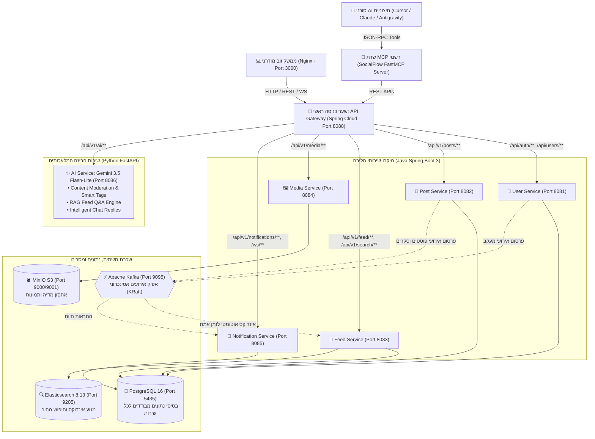

# 🌊 SocialFlow — פלטפורמת רשת חברתית מבוזרת ומבוססת בינה מלאכותית (AI)

[](https://www.oracle.com/java/)
[](https://spring.io/projects/spring-boot)
[](https://spring.io/projects/spring-cloud-gateway)
[](https://aistudio.google.com/)
[-blue.svg?style=flat)](https://modelcontextprotocol.io/)
[](https://kafka.apache.org/)
[](https://www.elastic.co/)
[](https://www.postgresql.org/)
[](https://min.io/)
[](https://www.docker.com/)

**SocialFlow** היא פלטפורמת רשת חברתית מתקדמת ברמת Enterprise, הבנויה בארכיטקטורת מיקרו-שירותים מבוזרת ומונחית אירועים (Event-Driven Microservices), המשולבת מקצה לקצה עם מנוע בינה מלאכותית **Google Gemini 3.5 Flash-Lite**, שרת **MCP (Model Context Protocol)** וחיפוש סמנטי מבוסס **RAG**.

המערכת תוכננה על פי הדרישות המחמירות של תעשיית ההייטק (מבוסס סילבוס *Back End AI: Hi-Tech Gateway* מאת יניב ארד), ומספקת ביצועי זמן אמת, סקילביליות גבוהה, אבטחת נתונים מחמירה וממשק משתמש אלגנטי בסגנון Instagram ו-Facebook.

---

## 📑 תוכן העניינים
- [🏛 ארכיטקטורת המערכת](#-ארכיטקטורת-המערכת)
- [🧩 פירוט 12 המיקרו-שירותים והרכיבים](#-פירוט-12-המיקרו-שירותים-והרכיבים)
- [🌟 פיצ'רים מרכזיים במערכת](#-פיצרים-מרכזיים-במערכת)
- [🤖 יכולות ה-AI ומנוע ה-RAG (Gemini 3.5 Flash-Lite)](#-יכולות-ה-ai-ומנוע-ה-rag-gemini-35-flash-lite)
- [🔌 שרת ה-MCP הרשמי (Model Context Protocol)](#-שרת-ה-mcp-הרשמי-model-context-protocol)
- [⚡ ארכיטקטורה מונחית אירועים (Kafka Topics)](#-ארכיטקטורה-מונחית-אירועים-kafka-topics)
- [🌐 מיפוי פורטים וקונטיינרים](#-מיפוי-פורטים-וקונטיינרים)
- [📡 תיעוד ה-REST API וה-WebSocket](#-תיעוד-ה-rest-api-וה-websocket)
- [🚀 מדריך התקנה והרצה מהירה](#-מדריך-התקנה-והרצה-מהירה)
- [🔒 אבטחה ושמירת מפתחות סודיים](#-אבטחה-ושמירת-מפתחות-סודיים)
- [🧪 בדיקות אינטגרציה ו-CI/CD](#-בדיקות-אינטגרציה-ו-cicd)
- [📁 מבנה הקבצים והתיקיות בפרויקט](#-מבנה-הקבצים-והתיקיות-בפרויקט)
- [👨‍💻 יוצר ורישיון](#-יוצר-ורישיון)

---

## 🏛 ארכיטקטורת המערכת

המערכת מבוססת על עקרון **Database-per-Service** וניתוק צימוד (Decoupling) מלא בין השירותים. כל התקשורת החיצונית מנותבת דרך **API Gateway**, העברת הנתונים הכבדים מתבצעת אסינכרונית דרך **Apache Kafka**, חיפושי הפיד מואצים באמצעות **Elasticsearch**, קובצי המדיה נשמרים ב-**MinIO S3**, ורכיבי ה-AI מנוהלים עצמאית בשירות **FastAPI Python**.



---

## 🧩 פירוט 12 המיקרו-שירותים והרכיבים

| # | שם השירות / קונטיינר | טכנולוגיה | פורט מארח | תפקיד ותחומי אחריות |
| :---: | :--- | :--- | :---: | :--- |
| 1 | **`socialflow-frontend`** | Nginx Alpine, Vanilla JS, CSS3, HTML5 | `3000` | ממשק לקוח מתקדם, לוח סטוריז, צ'אט מסנג'ר חי, הצבעות סקרים, עיצוב Glassmorphism ותמיכה ב-RTL. |
| 2 | **`socialflow-api-gateway`** | Spring Cloud Gateway (Netty Async) | `8088` | ניתוב מרכזי, בדיקת טוקני JWT, העברת כותרות זיהוי, ניהול מדיניות CORS וחסימת שגיאות. |
| 3 | **`socialflow-user-service`** | Spring Boot 3, Spring Security, JPA | `8081` | ניהול משתמשים, רישום והתחברות ב-JWT, פרופילים אישיים, מעקב והסרת מעקב (`Follow / Unfollow`). |
| 4 | **`socialflow-post-service`** | Spring Boot 3, Hibernate, Kafka Producer | `8082` | יצירת פוסטים, סקרים אינטראקטיביים עם הצבעות חיות, 6 סוגי Reactions, תגובות, Reposts וסימניות. |
| 5 | **`socialflow-feed-service`** | Spring Boot 3, Elasticsearch Client | `8083` | בניית פיד מותאם אישית ("עבורך", "נעקבים", "פופולרי"), חישוב האשטאגים חמים וחיפוש טקסט מלא. |
| 6 | **`socialflow-media-service`** | Spring Boot 3, AWS S3 Java SDK v2 | `8084` | שירות העלאת קבצים ותמונות, הפקת Presigned URLs מאובטחים, וחיבור ישיר ל-S3. |
| 7 | **`socialflow-notification-service`** | Spring Boot 3, WebSocket (STOMP), JPA | `8085` | ניהול התראות בזמן אמת דרך WebSockets ונקודות קצה REST עם מעקב אחרי התראות שנקראו. |
| 8 | **`socialflow-ai-service`** | Python 3.11, FastAPI, Google GenAI SDK | `8086` | מנוע הבינה המלאכותית: ניתוח פוסטים עם Gemini 3.5 Flash-Lite, חיפוש RAG בפיד ומענה בצ'אט. |
| 9 | **`socialflow-postgres`** | PostgreSQL 16 Alpine | `5435` | מסד הנתונים הרלציוני המרכזי עם סכמות ייעודיות לכל שירות (`user_db`, `post_db`, `feed_db`, `notif_db`). |
| 10 | **`socialflow-kafka`** | Confluent Kafka 7.6 (KRaft mode) | `9095` | מתווך מסרים מבוזר להעברת אירועים אסינכרונית בקצב גבוה ללא תלות ב-Zookeeper. |
| 11 | **`socialflow-elasticsearch`** | Elasticsearch 8.13.0 | `9205` | מנוע חיפוש סקילבילי ואינדוקס מהיר של פוסטים, כותבים, תגיות ומדדי מעורבות. |
| 12 | **`socialflow-minio`** | MinIO Object Storage (S3 API) | `9000` / `9001` | שרת אחסון אובייקטים מקומי תואם AWS S3 לאחסון מאובטח של תמונות ומדיה. |

---

## 🌟 פיצ'רים מרכזיים במערכת

- **📊 סקרים אינטראקטיביים חיים**:
  - יצירת סקר ישירות מתיבת הפרסום (עד 5 אפשרויות בחירה).
  - הצבעה מיידית בלחיצה אחת עם שמירת בחירת המשתמש.
  - חישוב אחוזים אוטומטי ופסי התקדמות מונפשים בזמן אמת ללא ריענון הדף.
  - מניעת הצבעה כפולה ברמת השרת.
- **💬 צ'אט מסנג'ר פרטי (DMs)**:
  - מגירת שיחות צפה בסגנון Messenger / Instagram.
  - בחירת אנשי קשר מתוך חברי הרשת (דניאל לוי, נועה כהן, יובל ברק ועוד).
  - מנוע מענה חכם ואנושי בעברית המשולב עם מודל ה-AI.
- **⭕ סטוריז זמניים (Stories ל-24 שעות)**:
  - מגש סטוריז עליון בראש הפיד עם טבעות גרדיאנט צבעוניות וזוהרות.
  - העלאת סטורי אישי בלחיצה על כפתור ה-`+`.
  - נגן סטוריז ייעודי במסך מלא עם פס התקדמות אנימטיבי לפי זמן.
- **👍 מערכת Reactions מתקדמת**:
  - תמיכה ב-6 רגשות שונים: `👍 אהבתי`, `❤️ אוהב`, `🎉 חוגג`, `🤝 תומך`, `💡 מעניין`, `😂 מצחיק`.
  - מגש אימוג'ים צף בריחוף עכבר ומנהל מעורבות אינטראקטיבי.
- **📰 מגוון תצוגות פיד**:
  - **עבורך (For You)**: פיד אלגוריתמי המחשב ציוני מעורבות (Engagement Score).
  - **נעקבים (Following)**: עדכונים כרונולוגיים של יוצרים שאתה עוקב אחריהם.
  - **טרנדים (Trending)**: פוסטים שצברו את הפעילות הגבוהה ביותר.
  - **האשטאגים חמים**: איסוף וסיכום תגיות מובילות בזמן אמת.
- **🔔 התראות חיות בזמן אמת**:
  - חיבור חי דרך WebSocket (STOMP) ופילוח לפי משתמש.
  - תג מונה התראות אדום שמתעדכן אוטומטית.

---

## 🤖 יכולות ה-AI ומנוע ה-RAG (Gemini 3.5 Flash-Lite)

שירות ה-`ai-service` מריץ את הדור החדש של מודלי גוגל — **Gemini 3.5 Flash-Lite**, הידוע במהירות תגובה חריגה ועלויות יעילות במיוחד:

1. **✨ כפתור "שפר עם AI" (Magic Assist)**:
   - מנתח את טיוטת הפוסט שכתבת, משפר את הניסוח לרשת חברתית, מפיק האשטאגים רלוונטיים ומבצע בדיקת נאותות תוכן (Moderation Check).
2. **🔍 מנוע RAG ותשאול הפיד בשפה חופשית**:
   - מקבל שאלה חופשית מהמשתמש (למשל: *"מה הדעות על בינה מלאכותית בפוסטים האחרונים?"*).
   - שולף בזמן אמת את הפוסטים והסקרים העדכניים מ-`feed-service` ומ-`post-service` (Retrieval).
   - מזין את ההקשר ומפיק תשובה מנומקת ומדויקת בעברית הכוללת מקורות וציטוט פוסטים (Grounding).
3. **💬 מענה חכם בשיחות מסנג'ר**:
   - מפיק תגובות צ'אט אותנטיות, חבריות ומותאמות לשפת המשתמש.

---

## 🔌 שרת ה-MCP הרשמי (Model Context Protocol)

הפרויקט כולל שרת **Model Context Protocol** מלא בנתיב `mcp-server/socialflow_mcp_server.py`, המאפשר לחבר כלי AI מובילים ישירות לרשת החברתית:

### כלים (Tools) הזמינים לסוכני AI דרך ה-MCP:
- `socialflow_get_feed`: שליפת פוסטים וסקרים מהפיד.
- `socialflow_create_post`: פרסום פוסטים או סקרים חדשים בשם המשתמש.
- `socialflow_vote_poll`: הצבעה בסקר פעיל.
- `socialflow_search`: חיפוש פוסטים, תגיות ומשתמשים.
- `socialflow_ask_feed_rag`: תשאול סמנטי חכם של מה שקורה בפיד.
- `socialflow_system_health`: דוח בריאות שרתים ומצב מיקרו-שירותים.

### הגדרה ב-Cursor (`~/.cursor/mcp.json`):
```json
{
  "mcpServers": {
    "socialflow": {
      "command": "python",
      "args": ["C:/Users/kazam/Desktop/Social_Flow/mcp-server/socialflow_mcp_server.py"]
    }
  }
}
```

### הגדרה ב-Claude Desktop (`%APPDATA%/Claude/claude_desktop_config.json`):
```json
{
  "mcpServers": {
    "socialflow": {
      "command": "python",
      "args": ["C:/Users/kazam/Desktop/Social_Flow/mcp-server/socialflow_mcp_server.py"]
    }
  }
}
```

---

## ⚡ ארכיטקטורה מונחית אירועים (Kafka Topics)

שרת ה-Kafka רץ בפורט `9095` במצב KRaft ומנהל את העברת ההודעות:
- **`post-events`**: נשלח בעת יצירת פוסט, עריכתו או הוספת סקר. שירות הפיד מאזין ומעדכן מיידית את Elasticsearch.
- **`user-events`**: נשלח בעת מעקב אחרי משתמשים לשם עדכון גרף הקשרים בפיד הנעקבים.
- **`reaction-events`**: נשלח בעת סימון ריאקשן לצורך עדכון אלגוריתם הטרנדים.
- **`notification-events`**: נשלח לשירות ההתראות ומנותב בזמן אמת ל-WebSocket של המשתמש.

---

## 🌐 מיפוי פורטים וקונטיינרים

| שירות | פורט פנימי בקונטיינר | פורט גישה מקומי (Host) | כתובת גישה ישירה |
| :--- | :---: | :---: | :--- |
| **ממשק המשתמש (Frontend)** | `80` | **`3000`** | [http://localhost:3000](http://localhost:3000) |
| **שער הכניסה (API Gateway)** | `8088` | **`8088`** | [http://localhost:8088](http://localhost:8088) |
| **שירות AI (Gemini 3.5 Flash-Lite)**| `8086` | **`8086`** | [http://localhost:8086/health](http://localhost:8086/health) |
| **שירות משתמשים (User Service)** | `8081` | **`8081`** | [http://localhost:8081](http://localhost:8081) |
| **שירות פוסטים (Post Service)** | `8082` | **`8082`** | [http://localhost:8082](http://localhost:8082) |
| **שירות פיד וחיפוש (Feed Service)**| `8083` | **`8083`** | [http://localhost:8083](http://localhost:8083) |
| **שירות מדיה וקבצים (Media)** | `8084` | **`8084`** | [http://localhost:8084](http://localhost:8084) |
| **שירות התראות (Notification)** | `8085` | **`8085`** | [http://localhost:8085](http://localhost:8085) |
| **אחסון MinIO S3 API** | `9000` | **`9000`** | [http://localhost:9000](http://localhost:9000) |
| **לוח ניהול MinIO Console** | `9001` | **`9001`** | [http://localhost:9001](http://localhost:9001) |
| **מסד נתונים PostgreSQL** | `5432` | **`5435`** | `localhost:5435` |
| **מתווך מסרים Apache Kafka** | `9092` | **`9095`** | `localhost:9095` |
| **מנוע חיפוש Elasticsearch** | `9200` | **`9205`** | [http://localhost:9205](http://localhost:9205) |

---

## 📡 תיעוד ה-REST API וה-WebSocket

כל הבקשות מבוצעות דרך שער הכניסה הראשי: `http://localhost:8088`.

### 1. אימות ומשתמשים (`/api/auth/**`, `/api/users/**`)
- `POST /api/auth/register` — הרשמת משתמש חדש.
- `POST /api/auth/login` — התחברות וקבלת JWT Token.
- `GET /api/users/profile/{username}` — קבלת פרטי פרופיל וסטטיסטיקות.
- `POST /api/users/{userId}/follow` — מעקב אחרי משתמש.
- `DELETE /api/users/{userId}/unfollow` — ביטול מעקב.

### 2. פוסטים, סקרים ואינטראקציות (`/api/v1/posts/**`)
- `POST /api/v1/posts` — יצירת פוסט חדש (תומך בטקסט, מדיה וסקר).
- `GET /api/v1/posts/{id}` — קבלת פוסט לפי מזהה כולל פרטי סקר מלאים.
- `POST /api/v1/posts/{id}/poll/vote?optionId={optId}` — הצבעה בסקר חי.
- `POST /api/v1/posts/{id}/reactions` — הוספה או עדכון Reaction (`LIKE`, `LOVE`, `CELEBRATE`, `SUPPORT`, `INSIGHTFUL`, `FUNNY`).
- `POST /api/v1/posts/{id}/comments` — הוספת תגובה לפוסט.
- `POST /api/v1/posts/{id}/repost` — שיתוף מחדש (Repost / Quote).
- `POST /api/v1/posts/{id}/bookmark` — הוספה או הסרה מסימניות אישיות.

### 3. פידים וחיפוש (`/api/v1/feed/**`, `/api/v1/search/**`)
- `GET /api/v1/feed/for-you?userId={id}&page=0&size=20` — פיד מותאם אישית חכם.
- `GET /api/v1/feed/following?userId={id}` — פיד נעקבים כרונולוגי.
- `GET /api/v1/feed/trending` — פיד פוסטים מובילים.
- `GET /api/v1/feed/trending-tags` — רשימת האשטאגים חמים.
- `GET /api/v1/search?query={q}` — חיפוש טקסט מלא ב-Elasticsearch.

### 4. שירותי בינה מלאכותית (`/api/v1/ai/**`)
- `POST /api/v1/ai/analyze` — ניתוח פוסט, בדיקת בטיחות והפקת האשטאגים.
- `POST /api/v1/ai/smart-replies` — הצעת 3 תגובות קצרות ומהירות לפוסט.
- `POST /api/v1/ai/ask-feed` — שאילתת RAG סמנטית על הפיד עם Gemini 3.5 Flash-Lite.
- `POST /api/v1/ai/chat-reply` — הפקת תגובת צ'אט אנושית בעברית עבור ה-Messenger.
- `POST /api/v1/ai/config` — עדכון מפתח API והגדרות מודל בזמן ריצה.

### 5. התראות ו-WebSocket (`/api/v1/notifications/**`, `/ws`)
- `GET /api/v1/notifications` — שליפת התראות המשתמש.
- `PUT /api/v1/notifications/read-all` — סימון כל ההתראות כנקראו.
- `WS /ws` — חיבור SockJS / STOMP להזרמת התראות חיות.

---

## 🚀 מדריך התקנה והרצה מהירה

### דרישות מקדימות
- **[Docker Desktop](https://www.docker.com/products/docker-desktop/)** (גרסה 24 ומעלה) פועל במחשב.
- **Git** מותקן.

### הרצה בפקודה אחת (Docker Compose):
```bash
# 1. שכפול המאגר
git clone https://github.com/IDAN2468D/Social_Flow.git
cd Social_Flow

# 2. הרמת כל 12 הקונטיינרים ברקע
docker compose up -d --build
```

### בדיקת סטטוס הקונטיינרים:
```bash
docker compose ps
```

לאחר שהקונטיינרים פועלים, פתח את הדפדפן בכתובת:
👉 **[http://localhost:3000](http://localhost:3000)**

---

## 🔒 אבטחה ושמירת מפתחות סודיים

1. **הגנה מלאה ב-Git**: קובץ [`.gitignore`](.gitignore) מוגדר לחסום לחלוטין קובצי `.env` וסודות.
2. **הגדרת מפתח ה-Gemini שלך**:
   - המפתח נשמר מקומית בקובץ `.env` בתיקיית השורש:
     ```env
     GEMINI_API_KEY=your_gemini_api_key_here
     GEMINI_MODEL=gemini-3.5-flash-lite
     ```
   - הקונטיינר טוען אותו אוטומטית בעלייה, והוא לעולם אינו מודפס בלוגים או מועלה ל-GitHub.

---

## 🧪 בדיקות אינטגרציה ו-CI/CD

- **בדיקות מקומיות**:
  ```bash
  mvn test
  ```
- **צינור אוטומטי (CI/CD Pipeline)**:
  קובץ ה-Workflow בנתיב [`.github/workflows/ci.yml`](.github/workflows/ci.yml) מריץ בכל `Push` ו-`Pull Request` בדיקת קומפילציה, אריזת שירותים והרצת בדיקות יחידה ואינטגרציה באופן אוטומטי בענן.
- **אוסף Postman מוכן**:
  בתיקיית `postman/` קיים קובץ `SocialFlow.postman_collection.json` לבדיקת כל נקודות הקצה במערכת.

---

## 📁 מבנה הקבצים והתיקיות בפרויקט

```text
Social_Flow/
├── .github/
│   └── workflows/ci.yml           # צינור בדיקות ואינטגרציה אוטומטי של GitHub Actions
├── .gitignore                     # חסימת קבצים רגישים, target וסביבה מ-Git
├── README.md                      # מסמך התיעוד המלא של הפרויקט
├── docker-compose.yml             # תזמור 12 הקונטיינרים והרשתות
├── init-db.sql                    # סקריפט איתחול סכמות PostgreSQL
├── pom.xml                        # קובץ Maven ראשי המאגד את כל המודולים
│
├── api-gateway/                   # שער כניסה (Spring Cloud Gateway - 8088)
├── user-service/                  # שירות משתמשים ואימות JWT (8081)
├── post-service/                  # שירות פוסטים, סקרים, תגובות וריאקשנים (8082)
├── feed-service/                  # שירות פיד וחיפוש Elasticsearch (8083)
├── media-service/                 # שירות העלאת מדיה וחיבור MinIO S3 (8084)
├── notification-service/          # שירות התראות ו-WebSocket STOMP (8085)
├── ai-service/                    # שירות בינה מלאכותית Gemini 3.5 Flash-Lite ו-RAG (8086)
├── mcp-server/                    # שרת Model Context Protocol עבור סוכני AI
│   ├── socialflow_mcp_server.py   # שרת ה-MCP הרשמי של SocialFlow
│   └── README.md                  # הוראות חיבור ל-Cursor ול-Claude Desktop
│
├── frontend/                      # ממשק משתמש מלא (Nginx - 3000)
│   ├── index.html                 # מבנה העמוד: פיד, סטוריז, מסנג'ר, מודאלים
│   ├── index.css                  # עיצוב מודרני, אפקטי Glassmorphism, Responsive ו-RTL
│   └── app.js                     # לוגיקת לקוח מלאה: הצבעת סקרים, מענה AI, שיחות וסטוריז
└── postman/                       # אוסף קריאות API מוכן לבדיקות
```

---

## 👨‍💻 יוצר ורישיון

פותח בהשקעה רבה על ידי **[עידן קזם (Idan Kazam)](https://github.com/IDAN2468D)**.

פרויקט זה מופץ תחת רישיון **MIT License** — חופשי לשימוש, למידה, שיתוף והרחבה.
